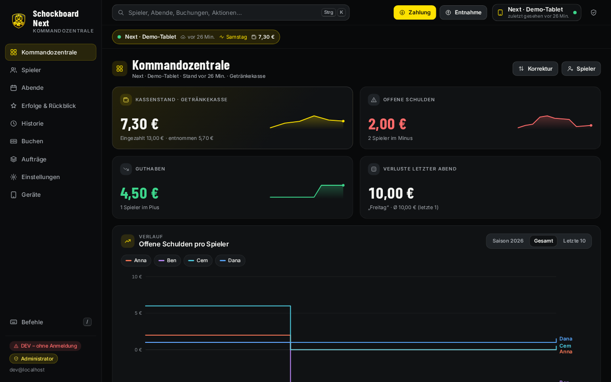
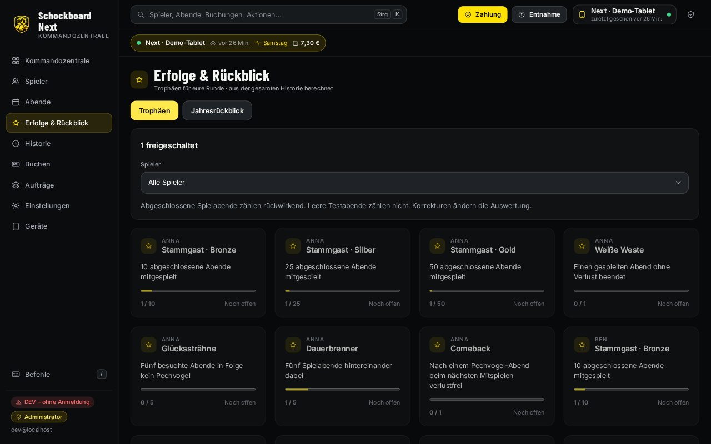
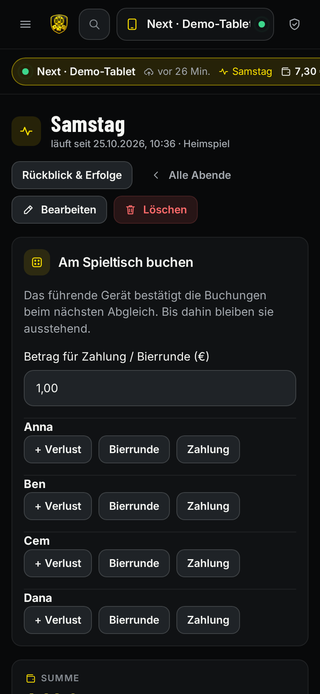
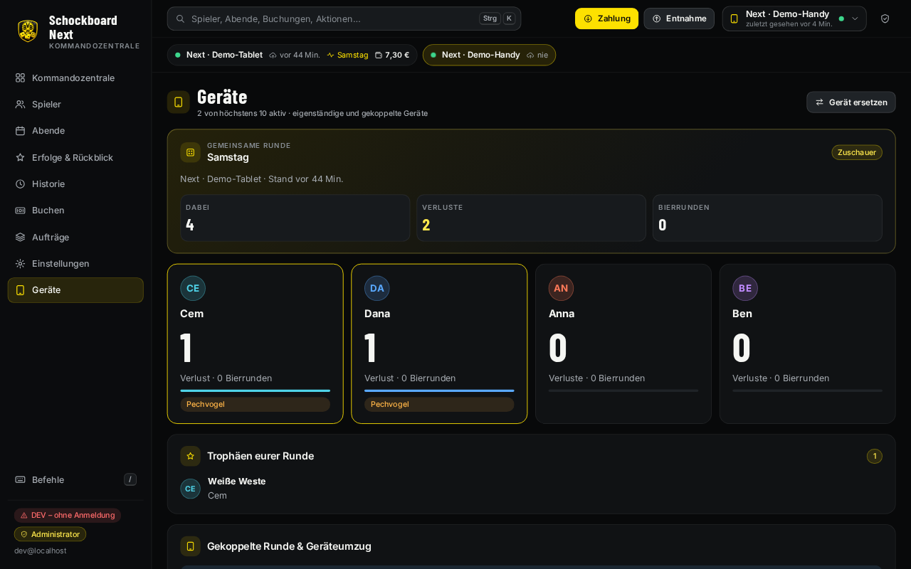

# Schockboard Next

Schockboard ist eine Android-App zur Verwaltung von Spielabenden, Verlusten und offenen Beträgen in der Runde.
Die Buchhaltung bleibt lokal auf dem Spieltisch (SQLite). Der optionale Server stellt die Web-Kommandozentrale, Geräte-Kopplung und geprüfte Buchungsaufträge bereit.

## Aktueller Stand

- Kein Login erforderlich
- APK ist als offizielles GitHub-Release verfügbar
- Fokus auf schnelle Bedienung während des Spielabends
- Adaptives Live-Spielbrett für Android-Smartphones und -Tablets (Hoch-/Querformat)
- BVB-09-Fan-Theme mit dem originalen Vereinslogo als lokal eingebundene PNG-Datei
- Vollständiger SQLite-Export und überprüfte Wiederherstellung über den Android-Dateiauswahldialog

## Funktionsübersicht

### Dashboard

- Überblick über Getränkekasse und offene Schulden
- Aktiver Spielabend mit Direktzugriff
- Größte offene Posten auf einen Blick
- Timeline der letzten Buchungen

### Spielabende

- Spielabend anlegen und starten
- Einsatz pro Verlust festlegen und später anpassen
- Anwesenheit pro Spieler direkt umschalten
- Gäste spontan zum laufenden Abend hinzufügen
- Spielabend abschließen
- Große Spieler-Kacheln mit direkter Schnellbuchung, Anwesenheit und Live-Feed

### Verluste & Schnellbuchung

- Verluste per Schnellbuttons (+ / -) erfassen
- Letzten Verlust pro Spieler rückgängig machen
- Storno entfernt den Verlust genau einmal; bestehende doppelte Korrekturen werden durch Migration v6 bereinigt
- Verluste optional mit Notiz dokumentieren

### Bierrunde (Sonderposten)

- Eigene Karte „Bierrunde“ im Spielabend
- Betrag frei definierbar (Standard: 5,00 €)
- Betrag wird einem anwesenden Spieler zugewiesen
- Bierrunden erscheinen im Log/Verlauf
- Bierrunden zählen **nicht** in den Abwesenheitsdurchschnitt für abwesende Stammspieler

### Abwesenheit & Regeln

- Automatische Zuschläge für abwesende Stammspieler beim Abschließen
- Unterstützte Modi:
  - kein Zuschlag
  - voller Durchschnitt
  - auf Abwesende aufgeteilter Durchschnitt
- Hausregel-Profil inkl. Schock-spezifischer Hinweise

### Historie & Korrekturen

- Chronologische Historie aller Buchungen
- Filter nach Spieler und Buchungstyp
- Korrekturen mit Begründung erfassen
- Audit-Einträge für wichtige Systemereignisse

### Kasse & Export

- Zahlungen in die Getränkekasse buchen
- Offene Beträge je Spieler transparent nachvollziehen
- CSV-Export für Historie und Kasse

## Daten & Technik

- Lokale Datenhaltung mit SQLite
- Klare Trennung von UI, Domain-Logik und Datenzugriff
- Robuste Domain-Logik mit automatisierten Tests
- Sicherungsformat: original SQLite-Datenbank, lokal exportiert; vor Restore werden SQLite-Integrität und Schockboard-Schema geprüft

## Schockboard 2.0 (WIP)

Die Hauptoberfläche ist für Touch-Interaktion neu aufgebaut. Im breiten Tablet-Fenster gibt es ein Spielerbrett links und Aktions-/Verlaufsbereiche rechts; auf schmalen Displays werden sie untereinander angeordnet. Im Tabletmodus sitzt die Navigation als seitliche Leiste.

Der BVB-09-Look verwendet das echte BVB-Logo aus [Wikimedia Commons](https://commons.wikimedia.org/wiki/File:Borussia_Dortmund_logo.svg) (ursprünglich von bvb.de). Die Bilddatei ist dort als gemeinfrei wegen fehlender Schöpfungshöhe gekennzeichnet; **Markenrechte bleiben unberührt**. Schockboard ist ein inoffizielles Fan-Projekt ohne Verbindung zum Verein. Next verwendet das eigene Paket `de.schockboard.next` und lässt sich neben `de.schockboard.apk` installieren. Beide Apps haben getrennte Daten. Zum Umstieg die alte SQLite-Sicherung in Next unter Setup wiederherstellen; danach nur Next für neue Buchungen verwenden. Die alte App bleibt als unveränderter Rückfall erhalten.

## Release

Die aktuelle APK ist im Bereich **Releases** dieses Repositories verfügbar.

## Screenshots

Web-Kommandozentrale und Trophäen am Desktop sowie die Buchungsansicht bei Handybreite. Alle Bilder verwenden ausschließlich die Beispieldaten aus `server/scripts/demo-data.ts` (Anna, Ben, Cem und Dana). Die lokale Demo läuft ohne Anmeldung; der produktive Server bleibt zugangsgeschützt.

Die gekoppelte Runde zeigt Spieler-Kacheln, Verluste, Bierrunden und Trophäen auch auf Zuschauergeräten. Im Web steht sie unter **Geräte**, sobald ein gekoppeltes Gerät ausgewählt ist. [Ansicht bei Handybreite](docs/screenshots/web-zuschauer-handy.png).

## Geräte, Erfolge und Sicherungen

- **Geräte & Runde:** QR-Einladungen sind fünf Minuten gültig und einmal verwendbar. Neue Geräte sind Zuschauer. Der Spieltisch oder ein Web-Administrator gibt Bedienrechte für Verluste, Bierrunden und Zahlungen frei. Der Spieltisch bestätigt jeden Auftrag; Wiederholungen mit derselben Kennung werden nicht doppelt gebucht. Zuschauer erhalten keine persönlichen Kontostände oder Buchungsnotizen.
- **Geräteumzug zwischen Next-Installationen:** Das Quellgerät sichert und sperrt seine Buchhaltung. Das Ziel sichert den eigenen Stand, übernimmt die vollständige Datenbank und bestätigt deren Prüfsumme. Die Quelle bleibt danach Zuschauer. Bei unterbrochener Übertragung unter Geräte & Runde fortsetzen; ein begonnener Import kann nur am Ziel mit Wiederherstellung seiner Sicherheitskopie abgebrochen werden. Datenstände werden nicht zusammengeführt.
- **Trophäen:** Stammgast (10/25/50), Weiße Weste, Glückssträhne, Dauerbrenner und Comeback werden aus abgeschlossenen, nicht leeren Abenden berechnet. Historische Korrekturen ändern Fortschritt und Freischaltungen.
- **Rückblicke:** Abend oder Jahr als PNG teilen, mit allen Teilnehmern und freigeschalteten Erfolgen. Persönliche Kontostände nur nach ausdrücklicher Auswahl. App und Web verwenden dieselbe Auswertung und Grafik.
- **Setup:** Vibration, Erfolgsanimationen und automatische Abend-Sicherungen; zehn automatische Stände, zusätzliche Sicherheitskopien vor Wiederherstellung/Umzug. Der Webserver hält die letzten zehn empfangenen Abendabschlüsse als Download bereit. Die Tischsperre schützt gegen versehentliche Berührungen, sie ist keine Zugangssperre.
- **Tablet:** Filter behalten ihre natürliche Höhe, Kennzahlen/Rekorde ihre Inhaltshöhe. Feste Seiten berücksichtigen die Android-Taskleiste.
- **Tischsperre:** Die Spielanzeige bleibt sichtbar. Zum Freigeben zuerst „Entsperren“, dann „Jetzt freigeben“ antippen; kein langes Halten erforderlich. App und Web verwenden dieselben zwei Schritte.

Das neue App-Symbol wurde mit dem Imagegen-Werkzeug als eigenes Fan-Icon erzeugt: schwarzer/gelber Schild mit BVB-09-Anspielung und drei Würfeln, transparent, ohne Hintergrundszene. `assets/next-icon.png` ist das Vollbild; `assets/next-icon-foreground.png` enthält zusätzlichen transparenten Rand für Android-Masken. Die Web-Kommandozentrale nutzt dasselbe Motiv. Markenhinweis oben gilt weiterhin.
